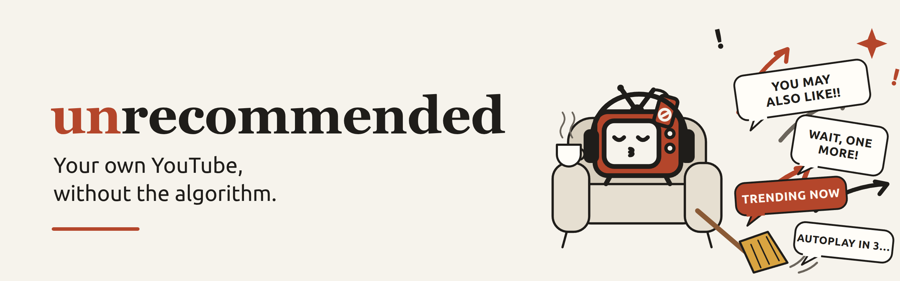
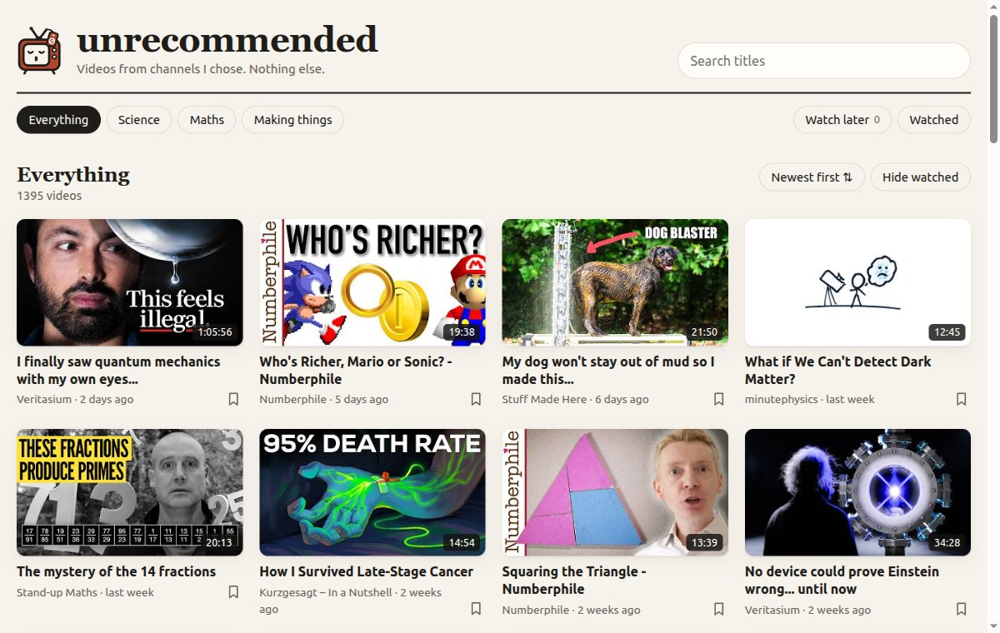

You list the channels you like. unrecommended turns them into a small website,
hosted for free on GitHub Pages, that shows only their videos: no comments, no
"up next" picked by YouTube, no home feed deciding what you watch. When a
video ends, the next one comes from *your* list.



This repository is a **template**: you make your own copy with a button, edit
one file in your browser, and GitHub builds and hosts your site. No
programming and nothing to install.

## Make your own in 5 steps

You need a free [GitHub account](https://github.com/signup).

1. **Copy it.** At the top of this page, click the green **Use this
   template** button, then **Create a new repository**. Give it a name (for
   example `videos`), keep it **Public**, and click **Create repository**.
2. **Turn on the website.** In your new repository, open **Settings** →
   **Pages** (in the menu on the left). Under **Build and deployment** →
   **Source**, choose **GitHub Actions**.
3. **List your channels.** Back on your repository's main page, click the
   file `channels.yaml`, then the pencil icon (**Edit this file**). Change the
   title and replace the example channels with yours: open a channel on
   YouTube and copy the address from the browser, such as
   `https://www.youtube.com/@3blue1brown`. Keep the layout of the example:
   spaces at the start of lines, and `- ` in front of each channel.
4. **Save.** Click **Commit changes…** and then **Commit changes** again.
5. **Wait two or three minutes**, then visit
   `https://<your-user-name>.github.io/<your-repository-name>/`.
   You can follow the build on the **Actions** tab: a yellow dot means it is
   running, a green tick means your site is up.

Every day after that, GitHub checks your channels for new videos by itself.

Optional, but nice: on your repository's main page, click the ⚙️ next to
**About**, add the topic **`unrecommended`**, and paste your site's address
into **Website**. The topic puts your list on
[github.com/topics/unrecommended](https://github.com/topics/unrecommended),
where people can find each other's lists.

## Using the site

It works the same on computers, tablets and phones (upright or sideways).

- **Groups** across the top are the groups from your `channels.yaml`.
  **Everything** shows all channels together, newest first. Click a channel's
  name to see only that channel.
- **Search** looks through the titles of the list you are on.
- **TV mode** plays full screen with simple controls of its own. YouTube's
  buttons, links and end screens can't be clicked, and when a video ends the
  next one starts. Keys: space pauses, ← and → jump 10 seconds, `n` is the
  next video, `t` turns TV mode on and off.
- The **bookmark** under a video saves it to **Watch later**. Videos you
  finish are marked **Watched**; **Hide watched** hides them.

**Watched**, **Watch later** and where you stopped in each video are kept in
your browser only, never sent anywhere. Another device or browser starts
empty. To move them, use **About this list and your data** (at the bottom of
the page): **Save to a file** there, then **Load from a file** on the other
device.

## Settings

Everything is in `channels.yaml`:

```yaml
site:
  title: Our videos          # name at the top of the page
  description: Hand-picked.  # one line under it ("" for none)
  about: |                   # longer text for the About page (see below)
    What this list is, who made it, why.
  logo: logo.svg             # see "Make it look like yours"
  favicon: favicon.svg
  accent: "#b4462b"          # colour of buttons and highlights
  kid_safe: false            # see below
  videos_per_channel: 200    # newest videos listed per channel

groups:
  Science:
    - https://www.youtube.com/@veritasium
    - "@minutephysics"                    # quotes needed when it starts with @
  Making things:
    - url: https://www.youtube.com/@StuffMadeHere
      name: Shane                         # show a different name

include:
  - https://github.com/alice/unrecommended          # all of Alice's channels
  - https://github.com/bob/unrecommended#Science    # only Bob's "Science" group
```

Channel addresses can be in any of the usual forms: `@name`,
`youtube.com/@name`, `youtube.com/channel/UC…`, `youtube.com/c/name`.
Only regular videos are listed: no Shorts, no livestreams.

### About your list

Like the description of a YouTube channel, `about:` is a longer text shown at
the top of your site's **About** page (the link at the bottom of every page):
what the list is for, who keeps it, how to suggest a channel. Write it under
`about: |`, every line indented by four spaces. An empty line starts a new
paragraph, and web addresses become links.

```yaml
  about: |
    Channels our family likes, picked by Ana and Leo.

    Know a good channel? Tell us at https://example.org/suggest
```

### Make it look like yours

You don't need to touch any code. Everything is done in the GitHub website:

1. **Your own logo** (the picture next to the title): in your repository,
   open the `site` folder, click **Add file** → **Upload files**, drop in
   your picture (PNG, JPG, SVG or WebP; square-ish works best, at least
   120×120 pixels) and click **Commit changes**. Then, in `channels.yaml`,
   write its name: `logo: my-logo.png`. To have no logo, write `logo: none`.
2. **Your own favicon** (the small icon in the browser tab and on phone home
   screens): upload a square picture the same way (at least 180×180 pixels,
   simple shapes, few details; it is shown very small) and write
   `favicon: my-icon.png`.
3. **Your own colour**: `accent: "#2b6cb4"` (keep the quotes) changes the
   colour of buttons and highlights. Pick one with any online "colour
   picker"; dark, strong colours read best.
4. **Your own README picture** (optional): `docs/banner.png` is the picture
   at the top of this page on GitHub. Replace it the same way, or delete the
   first line of `README.md`.

If a picture's name in `channels.yaml` doesn't match an uploaded file, the
build log shows a warning, and the browser shows no logo.

### Kid-safe mode

`kid_safe: true` is meant for a child's site:

- Videos always play in TV mode, full screen, with YouTube's own buttons
  and links covered so they can't be clicked.
- There are no links out to YouTube (or anywhere else) on the site.
- Only videos from your list can be played, and when one ends the next one
  from the same list starts. At the end of the list, playback stops.

It is not a lock: someone who knows how can still type another address into
the browser. Pair it with the browser's or the device's own parental
controls if you need more.

### Using other people's lists

Under `include:`, add someone else's unrecommended repository. Their
channels are added to your site and stay in sync with their list: when they
add a channel, it shows up on your site the next day. Add `#GroupName` to
take only one of their groups. The same group name in both lists becomes one
group.

- If a channel is in your list and in theirs, your entry wins.
- Only their `groups:` are used; their own `include:` list is not followed.
- If their repository disappears, your site keeps the last copy it saw and
  the build log shows a warning.

This is handy for families, classes and clubs: one person keeps a shared
list, everyone includes it and adds their own channels on top.

You can also start from someone's list: open their repository and click
**Use this template** there.

## Things to know

- **Your list is public.** On a free GitHub account, both the repository and
  the website can be seen by anyone with the address. For a child's site, that
  means anyone can see which channels the child watches (not what they
  actually watch: that stays in the browser).
- **Videos still come from YouTube.** The site plays them with YouTube's
  embedded player, so it needs an internet connection, and YouTube sees the
  views. The player uses `youtube-nocookie.com`, which reduces cookies but
  doesn't remove YouTube.
- **YouTube may play ads** before or during a video, as it does on any site
  that embeds its player. YouTube and the channel decide this; the site
  can't turn ads off, and the ads are not from your list. In TV mode and
  kid-safe mode the player is covered, so YouTube's **Skip** button can't be
  pressed either: an ad plays until it ends. If ads matter (for a child's
  site, say), test a few videos first; an ad blocker in the browser may
  help.
- **Creators' own end screens and cards** are part of the video. In normal
  mode they can be clicked; in TV mode and kid-safe mode they are covered.
- **Some videos can't be played outside YouTube**, because their channel
  turned that off. The site says so and offers the next video.
- **GitHub pauses the daily update after 60 days without changes** in the
  repository. GitHub emails you before it happens. To keep it going, edit
  anything (even one line in `channels.yaml`), or turn the workflow back on
  under **Actions** → **Update videos and publish** → **Enable workflow**.
- **Every list lives in a GitHub repository.** A browser can't read YouTube's
  channel lists by itself, so the daily GitHub job is what finds the videos.
  There is no way to share a list as only a link.

## Troubleshooting

**The site says "No videos yet", or the address shows a 404 page.**
The first build may still be running: check the **Actions** tab and wait for
the green tick. Make sure step 2 was done (**Settings** → **Pages** →
**Source: GitHub Actions**). Then open **Actions** → **Update videos and
publish** → **Run workflow** to build again.

**The Action failed (red ✗).**
Click the failed run, then the red step, and read the message near the end.
- *"channels.yaml line N: not valid YAML"*: the file's layout is off near
  that line. Most often a channel line is missing `- `, uses a tab instead of
  spaces, or a channel starting with `@` has no quotes around it. Compare
  with the example above.
- *"is a link to a video"* / *"is not a YouTube channel link"*: that line
  has the wrong kind of address. Open the channel's own page on YouTube and
  copy that.
- *"Branch … is not allowed to deploy to github-pages"*: the site is built
  from the `main` branch only. Make your changes there.
- *"Get Pages site failed"* or *"Not Found"* in the deploy step: Pages isn't
  turned on yet; see step 2.

**YouTube blocked GitHub ("confirm you're not a bot").**
YouTube sometimes refuses requests from GitHub's servers. The build then
uses each channel's RSS feed instead, which only has the newest 15 videos.
They are added to what your site already had, so nothing disappears, and the
next day usually works again. The build's summary page shows, for each
channel, whether the full list or only the feed was used.

If it keeps happening, or your site is new and has never had a full list,
build the list on your own computer (see below) and commit it.

**A channel shows no videos.**
Look at the build's summary page (click the latest run on the **Actions**
tab). It lists every channel with how many videos were found and what went
wrong. Check that the address opens the right channel in a browser. A channel
that only has Shorts or livestreams shows nothing, because only regular
videos are listed.

**A video won't play.**
Its channel doesn't allow playing it on other sites, or it was made private.
Nothing to fix on your side.

## Running it on your own computer (optional)

You need Python 3.10 or newer and `git`.

```sh
git clone https://github.com/<you>/<your-repository>.git
cd <your-repository>
python -m pip install -r requirements.txt   # yt-dlp and PyYAML
python scripts/update_videos.py             # writes site/videos.json
python -m http.server -d site 8000          # then open http://localhost:8000
```

If YouTube blocks GitHub's servers, a list built at home can go up to the
site: commit it with `git add -f site/videos.json`, then commit and push. The
daily build keeps every video in it and adds new ones on top.

For development: `pip install pytest ruff`, then `ruff check .`,
`ruff format --check .` and `pytest`.

## How it works

- `channels.yaml`: your settings and channels.
- `scripts/update_videos.py`: lists each channel's regular videos with
  [yt-dlp](https://github.com/yt-dlp/yt-dlp), falling back to the channel's
  RSS feed and the site's previous list when that fails, and writes
  `videos.json`.
- `site/`: the web page (`index.html`, `style.css`, `app.js`). Plain HTML and
  JavaScript, no build step. It plays videos with the
  [YouTube IFrame Player API](https://developers.google.com/youtube/iframe_api_reference),
  which needs no key.
- `.github/workflows/build.yml`: runs the script on every change and once
  a day, and publishes `site/` with the new `videos.json` to GitHub Pages.
  No secrets or API keys needed.
- `.github/workflows/checks.yml`: lint and tests, run only when code changes.
- Artwork: `scripts/make_art.py` draws `site/logo.svg`, `site/favicon.svg`
  and `docs/banner.svg`. `docs/banner.png` and `site/apple-touch-icon.png`
  are renderings of them, and `docs/brand-board.webp` is the AI-generated
  sketch the drawings are based on. To use your own pictures instead, see
  "Make it look like yours" above.
- The small "Made with unrecommended" line at the bottom of every page links
  back to this template so visitors know they can make their own. It is
  hidden on kid-safe sites, which link nowhere outside the list.

## License

[MIT](LICENSE)
